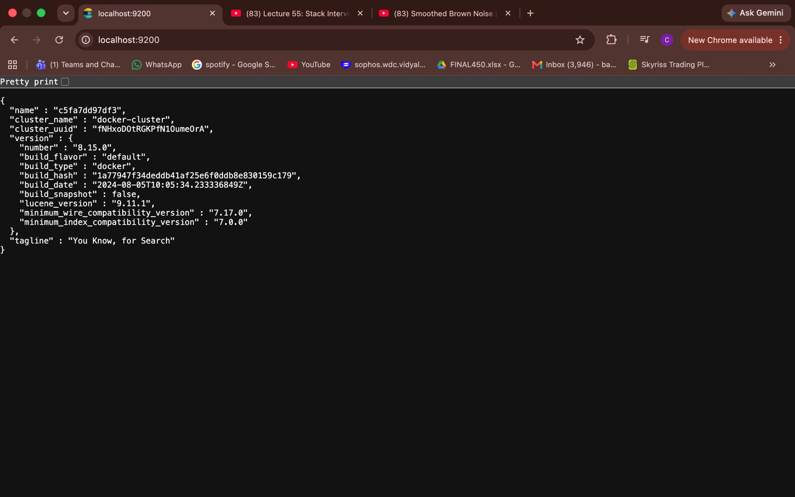
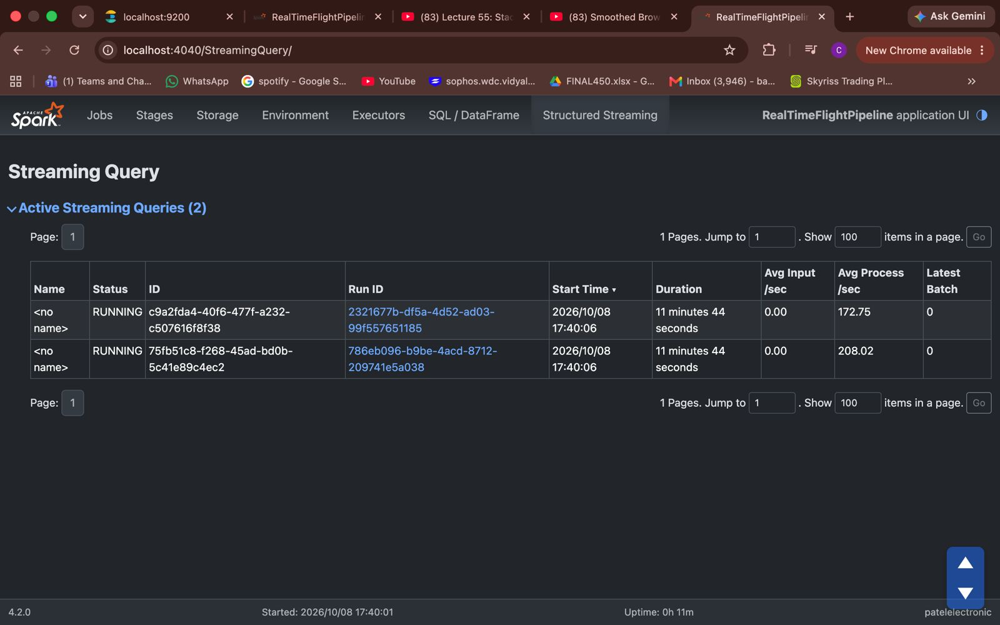
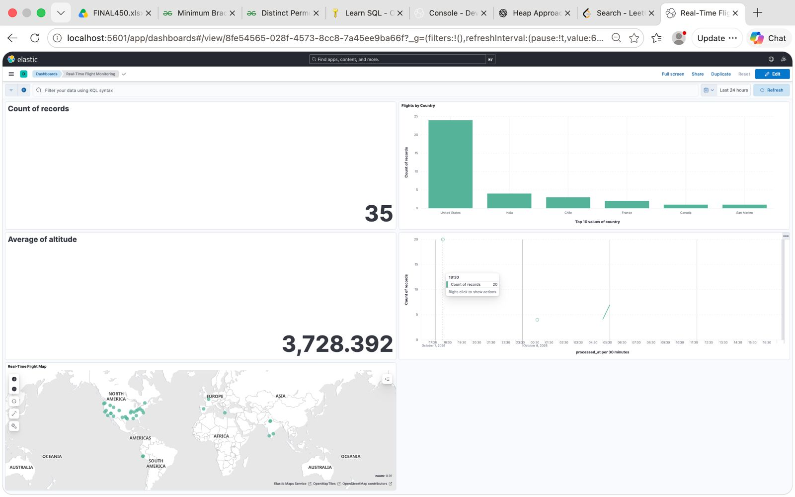

# ✈️ Real-Time Flight Data Pipeline

A real-time Big Data Engineering project that collects live aircraft data from the OpenSky Network API, streams events through Apache Kafka, processes them using Apache Spark Structured Streaming, indexes the latest aircraft information in Elasticsearch, and stores historical observations in Amazon S3.

The project demonstrates practical data engineering concepts including real-time ingestion, event streaming, distributed processing, data lake architecture, cloud storage, containerization, and data visualization.

---

## 📌 Table of Contents

- [Project Overview](#-project-overview)
- [Problem Statement](#-problem-statement)
- [Architecture](#️-architecture)
- [Features](#-features)
- [Technology Stack](#️-technology-stack)
- [Project Structure](#-project-structure)
- [Data Flow](#-data-flow)
- [Kafka Configuration](#-kafka-configuration)
- [Spark Structured Streaming](#-spark-structured-streaming)
- [Elasticsearch](#-elasticsearch)
- [Amazon S3 Data Lake](#️-amazon-s3-data-lake)
- [Kibana Dashboard](#-kibana-dashboard)
- [Docker Setup](#-docker-setup)
- [Installation and Configuration](#️-installation-and-configuration)
- [Running the Pipeline](#️-running-the-pipeline)
- [Verification](#-verification)
- [Key Engineering Concepts](#-key-engineering-concepts)
- [Security Considerations](#-security-considerations)
- [Future Improvements](#-future-improvements)
- [Author](#-author)

---

## 🚀 Project Overview

Aircraft continuously generate state information, including their geographical position, altitude, velocity, and identification details.

This project builds a streaming data pipeline that collects aircraft information from the OpenSky Network API and processes it using modern data engineering technologies.

The pipeline produces two outputs:

**1. Real-Time Flight Monitoring**

The latest known state of each aircraft is stored in Elasticsearch and visualized through Kibana.

**2. Historical Flight Data Lake**

Processed flight observations are stored in Amazon S3 as Parquet files, partitioned by year, month, and day.

The project uses Docker for its supporting services, while Apache Spark runs locally on the development machine.

## 🎯 Problem Statement

Traditional data processing systems often rely on periodically collected datasets. Such approaches can make it difficult to observe changing information as it arrives.

This project demonstrates how to build a streaming architecture that continuously ingests events, processes them in micro-batches, and makes the results available for both real-time visualization and historical analysis.

The goal is to understand how multiple data engineering technologies work together in an end-to-end pipeline.

## 🏗️ Architecture

```text
                  OpenSky Network API
                           |
                           v
                  Python Flight Producer
                           |
                           v
                    Apache Kafka
                    Topic: flights
                           |
                           v
             Spark Structured Streaming
                           |
                  +--------+--------+
                  |                 |
                  v                 v
           Elasticsearch         Amazon S3
                  |             Data Lake
                  v                 |
                Kibana              v
             Live Dashboard   Historical Parquet
```

### Architecture Diagram



### Technology Responsibilities

| Technology | Responsibility |
|---|---|
| OpenSky Network API | Provides aircraft state information |
| Python | Collects and prepares flight events |
| Apache Kafka | Ingests and streams flight events |
| Apache Spark Structured Streaming | Processes streaming data in micro-batches |
| Elasticsearch | Stores the latest state of each aircraft |
| Kibana | Visualizes flight information |
| Amazon S3 | Stores historical observations |
| Docker | Containerizes the supporting applications and services |
| Docker Compose | Defines and starts the configured Kafka service |
| Git and GitHub | Version control and project hosting |

## ✨ Features

- Collects aircraft state information from the OpenSky Network API.
- Publishes flight events to an Apache Kafka topic.
- Uses aircraft identifiers as Kafka message keys.
- Configures Kafka with three partitions.
- Processes incoming events using Spark Structured Streaming.
- Converts JSON messages into structured flight records.
- Stores the latest aircraft state in Elasticsearch.
- Creates geographical data using Elasticsearch's `geo_point` field.
- Stores historical observations in Amazon S3.
- Uses Parquet for historical data storage.
- Partitions historical data by year, month, and day.
- Maintains separate Spark checkpoints for Elasticsearch and S3.
- Visualizes flight information using Kibana.
- Uses Docker to simplify local service management.

## 🛠️ Technology Stack

| Category | Technologies |
|---|---|
| Programming | Python |
| Data Source | OpenSky Network API |
| Streaming | Apache Kafka 3.9.0 |
| Processing | Apache Spark Structured Streaming |
| Search and Indexing | Elasticsearch 8.15.0 |
| Visualization | Kibana 8.15.0 |
| Cloud Storage | Amazon S3 |
| Storage Format | Apache Parquet |
| Event Format | JSON |
| Containerization | Docker, Docker Compose |
| Cloud CLI | AWS CLI |
| Version Control | Git, GitHub |

## 📂 Project Structure

```text
realtime-flight-data-pipeline/
│
├── producer/
│   ├── flight_producer.py
│   ├── requirements.txt
│   └── Dockerfile
│
├── spark/
│   └── flight_stream.py
│
├── elasticsearch/
│   └── mapping.json
│
├── screenshots/
│   ├── kibana-dashboard.png
│   ├── localhost.png
│   └── spark-streaming.png
│
├── checkpoints/              # Generated at runtime
│   ├── elasticsearch/
│   └── s3_partitioned/
│
├── docker-compose.yml
└── README.md
```

**Note:** Checkpoint directories are generated by Spark at runtime. They do not need to be committed to GitHub.

## 🔄 Data Flow

### 1. Data Ingestion

The Python producer requests aircraft state information from the OpenSky Network API.

The extracted information includes:

- `icao24` — aircraft identifier
- `callsign` — flight callsign
- `country` — origin country reported by the API
- `longitude` — geographical longitude
- `latitude` — geographical latitude
- `altitude` — aircraft altitude
- `velocity` — aircraft velocity

The producer converts the extracted information into JSON events.

### 2. Event Streaming with Kafka

The producer publishes flight events to the Kafka topic:

```text
flights
```

The topic is configured with three partitions.

The aircraft identifier, `icao24`, is used as the Kafka message key.

This allows events with the same key to be routed consistently to the same partition under the normal partitioning configuration.

### 3. Stream Processing with Spark

Spark Structured Streaming reads flight events from Kafka.

The processing pipeline:

1. Reads messages from the Kafka topic.
2. Extracts the JSON payload from each message.
3. Converts the payload into structured columns.
4. Processes the incoming data in micro-batches.
5. Writes the processed data to Elasticsearch.
6. Writes historical observations to Amazon S3.

Separate streaming queries and checkpoint locations are used for the two output destinations.

### 4. Real-Time Indexing with Elasticsearch

Spark writes processed flight information to Elasticsearch.

The aircraft identifier is used as the Elasticsearch document ID.

For example:

```text
Document ID: 488284
```

When another observation arrives for the same aircraft, the existing document is updated instead of creating another document with the same ID.

Therefore, Elasticsearch represents the latest indexed state of each aircraft rather than maintaining a separate document for every observation.

### 5. Historical Storage with Amazon S3

Spark writes processed flight observations to Amazon S3 in Parquet format.

The data is organized using date-based partitions:

```text
flights/
└── year=2026/
    └── month=10/
        └── day=8/
            ├── part-....parquet
            └── part-....parquet
```

This structure supports efficient date-based analysis when the analytical engine can use partition pruning.

### 6. Visualization with Kibana

Kibana connects to Elasticsearch and visualizes the indexed flight data.

The dashboard provides an overview of aircraft information, including geographical distribution and flight statistics.

## ⚡ Kafka Configuration

Kafka runs in Docker using the Apache Kafka 3.9.0 image.

### Topic Configuration

| Setting | Value |
|---|---|
| Topic | `flights` |
| Partitions | 3 |
| Replication Factor | 1 |
| Local Bootstrap Server | `localhost:9092` |
| Kafka Mode | KRaft |

### Inspect the Kafka Topic

```bash
docker exec -it kafka /opt/kafka/bin/kafka-topics.sh \
  --bootstrap-server localhost:9092 \
  --describe \
  --topic flights
```

### Consume Flight Events

```bash
docker exec -it kafka /opt/kafka/bin/kafka-console-consumer.sh \
  --bootstrap-server localhost:9092 \
  --topic flights \
  --from-beginning
```

### Why Kafka?

Kafka acts as the event streaming layer between data ingestion and processing.

It allows the producer and Spark application to operate as separate components and provides partitioned event storage for consumers.

**Development configuration:** The current setup uses a single broker with replication factor 1. It is suitable for local development but does not provide broker-level high availability.

## 🔥 Spark Structured Streaming

Spark Structured Streaming continuously reads flight events from Kafka and processes them in micro-batches.

### Processing Responsibilities

- Reading Kafka messages.
- Parsing JSON data.
- Applying a structured schema.
- Preparing data for downstream systems.
- Writing the latest aircraft state to Elasticsearch.
- Writing historical observations to Amazon S3.

### Output Destinations

| Output | Destination | Purpose |
|---|---|---|
| Real-time output | Elasticsearch | Search and dashboard visualization |
| Historical output | Amazon S3 | Long-term storage and analytics |

### Checkpoint Configuration

The application uses separate checkpoint locations:

```text
checkpoints/elasticsearch
checkpoints/s3_partitioned
```

Checkpoints allow Spark to track streaming progress and support recovery from certain failures.

**Important:** Checkpoints belong to their corresponding streaming queries. Do not delete them casually in production, because doing so can affect recovery and data-processing guarantees.

### Spark Streaming Screenshot



### Start the Spark Application

From the project root, use the following command with the package versions configured for this project:

```bash
spark-submit \
  --packages org.apache.spark:spark-sql-kafka-0-10_2.13:4.2.0,org.apache.hadoop:hadoop-aws:3.5.0 \
  spark/flight_stream.py
```

The Spark Kafka connector must match the installed Spark and Scala versions.

The Hadoop AWS connector must also be compatible with the Hadoop libraries used by Spark.

## 🔎 Elasticsearch

Elasticsearch stores the latest indexed state of each aircraft.

The project uses a custom mapping:

```text
elasticsearch/mapping.json
```

### Mapping Fields

| Field | Elasticsearch Type | Purpose |
|---|---|---|
| `icao24` | `keyword` | Aircraft identifier |
| `callsign` | `keyword` | Flight callsign |
| `country` | `keyword` | Country information |
| `longitude` | `double` | Longitude coordinate |
| `latitude` | `double` | Latitude coordinate |
| `location` | `geo_point` | Geographical position |
| `altitude` | `double` | Aircraft altitude |
| `velocity` | `double` | Aircraft velocity |
| `processed_at` | `date` | Processing timestamp |

The `geo_point` field allows Kibana to display aircraft positions on a map.

### Check the Document Count

```bash
curl "http://localhost:9200/flights/_count?pretty"
```

### Retrieve Sample Documents

```bash
curl "http://localhost:9200/flights/_search?size=5&pretty"
```

These commands assume Elasticsearch is accessible locally without additional authentication.

### Why Can Elasticsearch Have Fewer Documents Than Kafka?

Kafka contains individual flight events, while Elasticsearch uses `icao24` as the document ID.

Repeated observations of the same aircraft update its existing document.

Consequently, the Elasticsearch document count can be significantly lower than the number of events processed by Spark.

## ☁️ Amazon S3 Data Lake

Amazon S3 stores historical flight observations for future analytical workloads.

The project uses the following bucket:

```text
s3://chetan-realtime-flight-data-2026/
```

The flight data is written under:

```text
s3://chetan-realtime-flight-data-2026/flights/
```

### Example Partition Structure

```text
flights/
└── year=2026/
    └── month=10/
        └── day=8/
            └── part-....snappy.parquet
```

The exact available partitions depend on when data was processed.

### List the Stored Objects

```bash
aws s3 ls \
  s3://chetan-realtime-flight-data-2026/flights/ \
  --recursive
```

### Why Amazon S3?

Amazon S3 provides scalable object storage that can be used to build a data lake.

It separates historical storage from the real-time indexing system.

### Why Parquet?

Apache Parquet is a columnar storage format commonly used in analytics.

Its benefits include:

- Efficient analytical data access.
- Columnar storage.
- Compression support.
- Compatibility with Spark and other analytical engines.

### Why Date-Based Partitioning?

Partitioning data by year, month, and day helps analytical engines identify relevant data for time-based queries.

For example, an analytical query for a particular day may avoid reading unrelated date partitions when partition pruning is supported.

### Future Analytics with Amazon Athena

The Parquet data stored in S3 can be queried using Amazon Athena after creating the required table or catalog metadata.

This can support historical analysis without requiring a continuously running Spark application.

## 📊 Kibana Dashboard

Kibana provides a visual overview of the latest aircraft information indexed in Elasticsearch.

The dashboard includes:

- Total indexed aircraft records.
- Flight distribution by country.
- Average aircraft altitude.
- Flight activity over time.
- Geographical distribution of aircraft on a map.

### Dashboard Screenshot



### Important Dashboard Note

If the dashboard appears empty, check:

1. Whether Elasticsearch contains flight documents.
2. Whether the Kibana data view uses the correct index pattern.
3. Whether `processed_at` is configured as the timestamp field.
4. Whether the selected dashboard time range includes the indexed timestamps.

The dashboard visualizes Elasticsearch data, not the complete historical dataset stored in S3.

## 🐳 Docker Setup

Docker is used to run the supporting services and containerized applications.

The current setup includes:

- Apache Kafka.
- The Python flight producer.
- Elasticsearch.
- Kibana.

Kafka is configured in `docker-compose.yml`. Other containers can be managed using their respective Docker configurations.

Apache Spark runs locally on the development machine.

### Start Kafka

From the project root:

```bash
docker compose up -d kafka
```

### Check Running Containers

```bash
docker ps
```

### View Kafka Logs

```bash
docker logs kafka
```

### Stop Services Defined in Docker Compose

```bash
docker compose down
```

This command stops and removes the containers and network managed by the Compose project. It does not automatically stop containers that were started independently.

**Note:** The Compose configuration uses a local single-broker Kafka setup. Production environments generally require additional configuration for security, durability, and availability.

## ⚙️ Installation and Configuration

### Prerequisites

Before running the project, install or configure:

- Python 3.
- Java compatible with the selected Spark release.
- Apache Spark.
- Docker Desktop.
- AWS CLI.
- An AWS account with permission to write to the target S3 bucket.

You also need access to the OpenSky Network API.

### 1. Clone the Repository

```bash
git clone <your-github-repository-url>
cd realtime-flight-data-pipeline
```

Replace the placeholder with your actual GitHub repository URL.

### 2. Create a Python Virtual Environment

```bash
python3 -m venv .venv
source .venv/bin/activate
```

### 3. Install Producer Dependencies

```bash
pip install -r producer/requirements.txt
```

### 4. Configure AWS Credentials

Configure the AWS CLI using your preferred credential method:

```bash
aws configure
```

Verify the active AWS identity:

```bash
aws sts get-caller-identity
```

Ensure the configured identity has permission to write to the target S3 bucket.

Do not commit AWS access keys, secret keys, session tokens, or other credentials to GitHub.

### 5. Configure the S3 Output Path

Check the output path in:

```text
spark/flight_stream.py
```

The expected format is:

```text
s3a://<your-bucket>/flights/
```

The current project uses:

```text
s3a://chetan-realtime-flight-data-2026/flights/
```

If you use a different bucket, update the application configuration accordingly.

### 6. Configure Docker Services

Start Kafka:

```bash
docker compose up -d kafka
```

Ensure Elasticsearch and Kibana are running using your configured Docker setup.

If you intend to run the producer in a container, ensure its Kafka bootstrap address is reachable from that container.

For example, `localhost:9092` refers to the current container itself when used inside a container. The appropriate Kafka address depends on the network configuration.

### 7. Verify Dependencies

Confirm that Spark is available:

```bash
spark-submit --version
```

Check Java:

```bash
java -version
```

Check Docker:

```bash
docker --version
docker compose version
```

## ▶️ Running the Pipeline

Run the components in the following order.

### Step 1: Start Kafka

```bash
docker compose up -d kafka
```

Verify the container:

```bash
docker ps
```

### Step 2: Verify the Kafka Topic

```bash
docker exec -it kafka /opt/kafka/bin/kafka-topics.sh \
  --bootstrap-server localhost:9092 \
  --list
```

If the `flights` topic does not exist, create it:

```bash
docker exec -it kafka /opt/kafka/bin/kafka-topics.sh \
  --bootstrap-server localhost:9092 \
  --create \
  --topic flights \
  --partitions 3 \
  --replication-factor 1
```

If the topic already exists, there is no need to create it again.

### Step 3: Start Elasticsearch and Kibana

Start these services using your configured Docker setup.

Confirm that Elasticsearch is accessible:

```bash
curl "http://localhost:9200"
```

Kibana should be accessible at:

```text
http://localhost:5601
```

### Step 4: Start the Flight Producer

If running the producer directly in the local Python environment:

```bash
python producer/flight_producer.py
```

The producer must be configured with a Kafka bootstrap address that is reachable from its execution environment.

If running the producer as a container, use its configured Docker image and networking settings.

### Step 5: Start Spark Structured Streaming

From the project root:

```bash
spark-submit \
  --packages org.apache.spark:spark-sql-kafka-0-10_2.13:4.2.0,org.apache.hadoop:hadoop-aws:3.5.0 \
  spark/flight_stream.py
```

Spark will begin reading events from Kafka and writing processed observations to the configured destinations.

Ensure the application has access to the required AWS credentials and compatible Hadoop AWS dependencies.

### Step 6: Verify Elasticsearch Output

```bash
curl "http://localhost:9200/flights/_count?pretty"
```

### Step 7: Verify Amazon S3 Output

```bash
aws s3 ls \
  s3://chetan-realtime-flight-data-2026/flights/ \
  --recursive
```

### Step 8: Open Kibana

Open:

```text
http://localhost:5601
```

Select the configured flight data view and open the flight monitoring dashboard.

## 📈 Results

The completed project demonstrates an end-to-end streaming data pipeline with the following capabilities:

- Collects live aircraft data from an external API.
- Publishes flight events through Apache Kafka.
- Processes streaming data using Spark Structured Streaming.
- Indexes the latest aircraft state in Elasticsearch.
- Stores historical observations in Amazon S3.
- Uses Parquet and date-based partitions for historical storage.
- Visualizes indexed flight information through Kibana.
- Uses Docker for the local development infrastructure.

The Elasticsearch document count can be lower than the number of processed Kafka events because repeated observations update the same aircraft document.

## 🧠 Key Engineering Concepts

This project provides hands-on experience with:

- Event-driven data ingestion.
- Kafka topics and partitions.
- Message keys and partition assignment.
- Spark Structured Streaming.
- Micro-batch processing.
- JSON parsing and structured schemas.
- Streaming checkpoints.
- Elasticsearch mappings and document IDs.
- Geospatial indexing and visualization.
- Data lake architecture.
- Parquet storage.
- Date-based partitioning.
- AWS S3 integration.
- Docker-based development environments.

## 🔐 Security Considerations

- Never commit AWS credentials or secrets to GitHub.
- Follow the principle of least privilege when configuring IAM permissions.
- Avoid exposing Kafka, Elasticsearch, or Kibana publicly without appropriate security controls.
- Use a suitable secrets-management solution for production deployments.
- Restrict access to S3 buckets and other cloud resources.
- Treat the local single-broker Kafka configuration as a development environment rather than a highly available production deployment.

## 🚧 Future Improvements

The project can be extended with additional data engineering and DevOps capabilities.

### Data Engineering

- Introduce Apache Airflow to orchestrate scheduled batch workflows.
- Query historical Parquet data using Amazon Athena.
- Add schema validation and data quality checks.
- Implement deduplication and improved error handling.
- Add data freshness and pipeline throughput metrics.

### Cloud and DevOps

- Provision AWS infrastructure using Terraform.
- Automate testing and builds using GitHub Actions.
- Improve application logging and monitoring.
- Explore managed cloud streaming services.
- Containerize the Spark application.
- Introduce Kubernetes for container orchestration where appropriate.
- Add deployment automation and infrastructure monitoring.

These are planned extensions and are not claimed as completed features of the current implementation.

## 👨‍💻 Author

**Chetan Barfa**

Electronics & Telecommunication Engineering Student

**Areas of Interest:**
- Data Engineering
- Big Data Processing
- Cloud Computing
- AWS
- DevOps

---

If you find this project useful, consider giving the repository a ⭐ on GitHub.